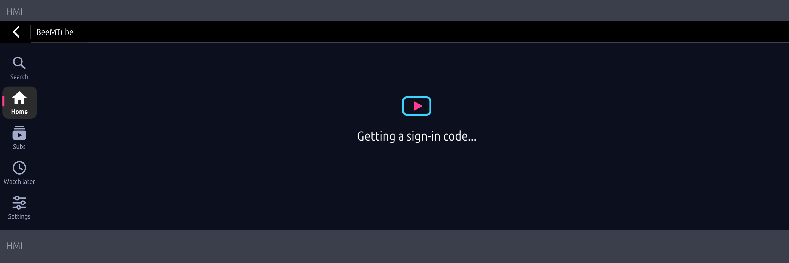
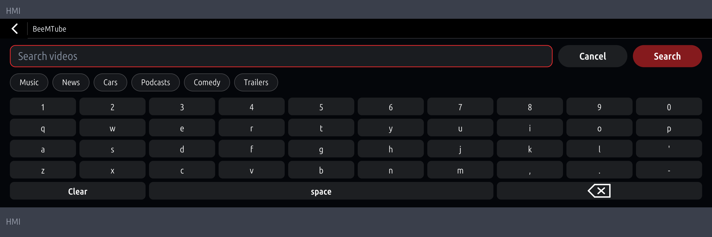
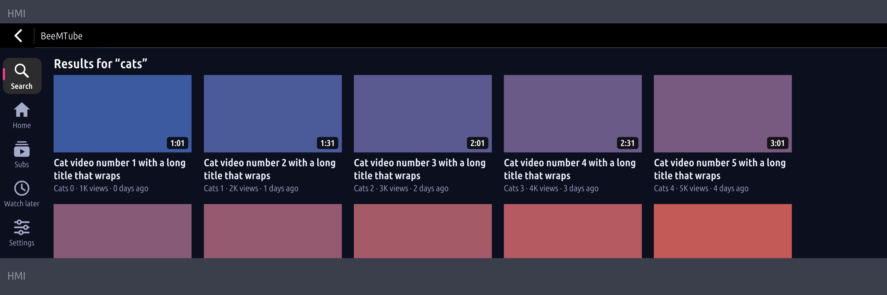
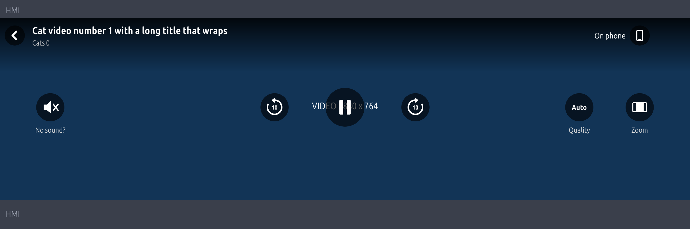
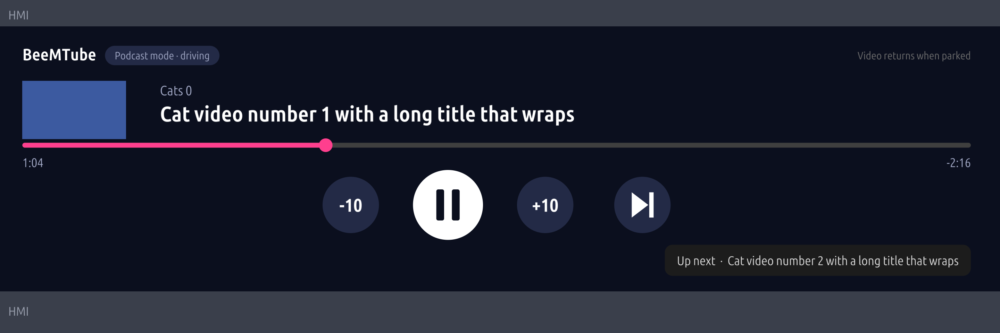
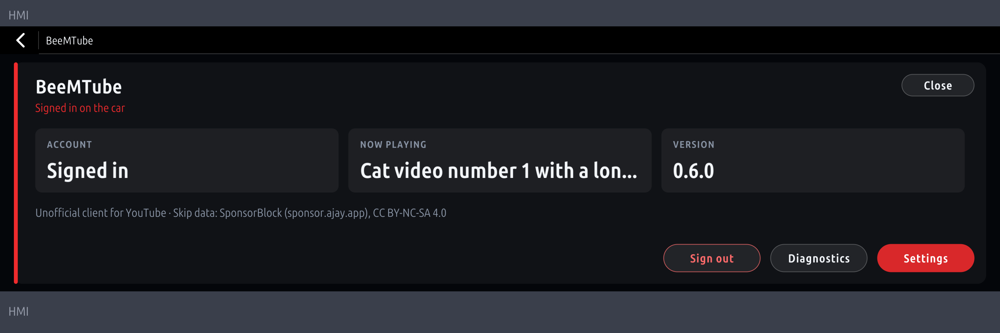

# BeeMTube

An unofficial YouTube client for the **BMW iDrive 8 head unit** (MGU, `ID8`), installed from the
[MGU Store](https://github.com/robertnisipeanu/mgu-store). Everything runs on the car, over the car's own internet
connection. BeeMTube is a rebuild of [RideTube](https://github.com/JustAnotherPU/ridetube) (GPL-3.0-or-later) for
iDrive 8, from the same code, with the part that iDrive 8 broke built again from the other end.

> **Experimental and unofficial.** Not affiliated with, endorsed by or sponsored by Google, YouTube or BMW. Use it at
> your own risk. You are responsible for following YouTube's Terms of Service and the laws of your country, and for
> using it safely: by default the picture shows only while the car is parked.

|  |  |
|---|---|
|  |  |
| Home: sign in with a code on your phone; the rail is Search, Home, Subscriptions, Watch later, Settings | Search with the on-screen keyboard (typing only while parked; recent searches as chips) |
|  |  |
| Results, five tiles a row on the wide iDrive 8 screen | The player; **No sound?** leaves a silent way out and the search looks on, the video never stops |
|  |  |
| While driving: the sound plays on, the picture becomes a podcast view, "Up next" queued | Settings: the account, Diagnostics, and the settings sheet |

> Rendered on a computer at the iDrive 8 screen size (2880 × 960) with demo data, through the app's own HMI stub
> (`kit/tools/test_beemtube8.js SHOTS=<dir>`), not photographed in a car. On the car the GPU draws the real video
> where the player shows a placeholder here.

## What this rebuild changes

On iDrive 8 the earlier app drew, searched and showed thumbnails, but **a video never played**: the service first had
to find a way to make sound, and the picture was not started until it had. It never did - the car does not offer the
media player iDrive 7 plays through, and it refused the service the audio focus - so a play ended in a long
"Preparing", an error, or nothing at all, and from the driver's seat the app looked dead.

BeeMTube is built the other way round:

- **The picture never waits for the sound.** A play starts the moment the video is ready, on the service's own clock
  (`native/beemtube-d/audio.js`). If no sound can be made, the video plays on in silence and the player says so. A
  play never fails, and never hangs, because of the sound.
- **The car is asked for sound by the app, not by the root service.** The service is a daemon nobody provisioned: it
  has no app id, no entry in the car's SOME/IP policies, and no interface descriptions of its own - which is why the
  car answered its asking with `BAD_ARGUMENT`. BeeMTube's **app** is a registered OAP app with BMW's own SDK, its own
  uid and the descriptions the app manager writes for it, so the asking happens there
  (`apps/wali_beemtube/audio8.js`), and the service only keeps the file, the picture and the clock.
- **The arguments are read, not guessed.** The audio focus is asked for with values of the types the car's own
  interface description declares (a number where it says a number), a handful of tries instead of hundreds.
- **Nothing is hammered or impersonated.** No silence is written to the car's sound devices to see which one answers;
  no other app's name is ever used; nothing of BMW's is loaded in the process that holds the control socket. On
  iDrive 8 the service loads no SOME/IP binding at all.
- **The sound can join a video that is already playing**, and can fall away again without taking the video with it.
  A player that gives no time of its own does not freeze the picture: the service counts the clock on itself.

What the car does with the asking is still unknown - **nobody has heard BeeMTube on an iDrive 8 car yet**. What is
different is that you now get the video either way, and that **Settings > Diagnostics** says exactly what this head
unit offered and answered, so one trip to the car settles it. Reports welcome in the issues.

## Install on an iDrive 8 car

1. Root SSH on the head unit and the [MGU Store](https://github.com/robertnisipeanu/mgu-store) installed (its
   README). Back up the head unit's coding before rooting it.
2. The car online through the Store's uplink (`mgu-uplink`: phone hotspot, USB LTE stick or Wi-Fi).
3. In the Store: Settings, **Add source**, type `waliworld/BeeMTube` and pick **Releases**.
4. Install **BeeMTube**. The Store installs with it, from this source, its service `beemtube-d` and Node.js 22
   (`jap-node22`); from its own source the renderer `mgu-render`, `mgu-python` and the deploy tool.
5. **Restart the head unit**: on iDrive 8 an app installs at the next start.
6. Open BeeMTube from All apps. Home shows a code: enter it at google.com/device on your phone to sign in (or search
   without signing in).

If RideTube is installed, remove it first: two services would both ask the car for its audio.

Uninstall: in BeeMTube's Settings (left rail), Sign out; then uninstall BeeMTube and its service in the Store.

## What it does

- **Home**, **Subscriptions** and **Watch later**, once you sign in on the car with the TV device sign-in (a code to
  enter on your phone; BeeMTube never sees your password).
- Search with an on-screen keyboard (typing only while parked; recent searches as buttons), channel pages, chapters,
  the video quality, and fill or fit for the picture.
- Skip segments from [SponsorBlock](https://sponsor.ajay.app) (sponsors, self-promotion, intros and similar).
- While driving, the picture is replaced by a podcast view (title, progress, controls) and the sound plays on. The
  picture comes back when the car is parked again.
- Nothing is stored for later. The video playing is downloaded to the head unit in full while it plays, then
  deleted: expect the video's whole size on your data plan, even if you stop early. The download stops if the head
  unit's storage gets low.
- Signed in, what you watch goes to your YouTube history, as on a TV.

## Where the sound comes from

A play asks for the ways in this order, and keeps the first that works for the next play
(`/var/opt/beemtube-d/state/sound.json`):

| | |
|---|---|
| **The car's media player** | The app asks the audio manager to connect our source and the car's generic OAP media player to play the file - iDrive 7's proven sequence, asked by the app instead of the service. |
| **The car's dynamic media player** | The app asks one of the car's entertainment instances for the audio focus (arguments built from the interface's own description), hands it a playlist with our file and starts it. |
| **This service's own player** | Where the app got our source connected, `ytaud` decodes the file and `ytalsa.py` writes the samples to that device of the car's audio router. A device is only used once the car is seen taking the samples at the pace of time - the honest test that something plays them. |
| **No sound** | The video plays on, and the player says "No sound on this car". |

If you can see a video playing and hear nothing, press **No sound?** on the player twice: that way is left out and
the search goes on under the playing picture. **Settings > Sound: start over** forgets all of it.

## Settings

- **Video while driving**: off by default. Leave it off unless the car is coded for video in motion and only
  passengers can see the screen. You use it at your own risk. It takes effect only once switched on while the car is
  parked: pressed while driving, the picture stays off until the next stop.
- **Fill the screen**: off by default (black bars); on, the picture is cropped to fill the screen.
- **Video quality**: auto (720p on Wi-Fi, 480p on phone data), 720p, 480p or 360p.
- **Show members-only videos**: off by default. A channel can also be hidden from its page.
- **SponsorBlock**, per category: skip, show a Skip button, or off.
- **Parked: pause when the 12 V battery is under** 60, 65 (default) or 70 %, or never.
- **Sign in** / **Sign out**, **Diagnostics** and **Sound: start over** in the rail's Settings.

The parked check reads the car's speed. A reading older than 5 seconds counts as driving.

## When something is wrong

**Settings > Diagnostics** is pages of plain text to read or photograph (a car has no log to send). It says the app's
and the service's versions, the renderer, the car's speed, **what the app could ask this head unit for** (which audio
interfaces it has descriptions for, which answered this app, how its proxies are called), where the sound comes from
now, what was tried and what the car answered, the car's sound devices as read from its own files, and the log's last
lines. The service also keeps the whole story of the last plays in `/var/opt/beemtube-d/log/sound.log`.

For a head unit BeeMTube does not play on, `tools/id8_collect.js` runs on the head unit, read only, over the SSH you
installed the Store with:

```sh
<your ssh command for the car> node < tools/id8_collect.js > beemtube-id8-data.txt
node tools/id8_unpack.js beemtube-id8-data.txt <folder>
```

It takes the interface descriptions, the app manager's and up to four apps' media code, the Store's status and
BeeMTube's logs; never the account files or other apps' data (the list is at the top of the script). What it takes
from the unit is BMW's: keep it private.

Other things worth knowing:

- **The tile greys out or opens nothing**: the app's log (`/var/opt/public/oap/oap_<uid>/data/wali_beemtube8.log`)
  has the entry module's lines (`boot: ...`): whether the SDK started, the start reason, the tile's steps, the page.
  No `boot:` line at all means the app's process did not get as far as its first line.
- **A grey page**: the HMI's own page under BeeMTube's screen has four status lines and the reason in its title. Our
  screen covers them while it draws, so a page you can read them on is one the picture did not reach.
- **The picture**: `ytdec` decodes on the Intel GPU with the head unit's Media SDK (`libmfxhw64`). The service logs
  at its start whether the head unit has it. Without it the sound plays and the picture says "video failed, audio
  only".
- **The app does not appear after installing**: the Store says why if the head unit could not build the package. One
  thing a strange head unit could refuse is this app's manifest naming the car's three audio interfaces (the
  rebuild's whole point): a build with `"audioProxies": false` in `apps/wali_beemtube/app.json` leaves them out, and
  the video then plays in silence. Please report it instead - that is a fact nobody has yet.

## Known limits

- Nobody has heard the sound on an iDrive 8 car. The video, the screen, touch, search and the thumbnails are the
  parts a car has run.
- yt-dlp breaks now and then when YouTube changes. A fixed release then needs a new yt-dlp (see
  `native/beemtube-d/README.md`, "Updating yt-dlp").
- H.264 only (up to 720p, 30 fps preferred), decoded on the head unit's GPU. A video with no H.264 stream does not
  play.
- Signing in uses the TV device sign-in that YouTube's TV apps use. The client id is read from YouTube's TV page when
  you sign in; BeeMTube ships none.
- Any app installed on the head unit can drive BeeMTube's service through its control socket (it is open to the group
  every app shares). Install only apps you trust; see `native/beemtube-d/README.md`, "Security notes".

## Layout

| Path | |
|---|---|
| `apps/wali_beemtube` | the app (Node 8, the iDrive's own app runtime); `audio8.js` asks the car for sound |
| `kit/` | the app kit (from idrive7-apps), with the iDrive 8 profile (`display.js`, `keyboard.js`, `id8/`) |
| `native/beemtube-d` | the service on the car: fetcher, player, account, search, thumbnails; `audio.js` holds the sinks (the clock, the app's plans, our own player) |
| `native/ytdec` | the H.264 decoder that draws into the renderer's video layer |
| `native/ytaud` | the AAC decoder (FAAD2, static) of the service's own player |
| `tools/release.py` | lays out the Store catalog (`catalog.json` and its assets) |

## Build and test on a computer

```sh
node kit/tools/test_runtime.js && node kit/tools/test_life.js && node kit/tools/test_parked.js \
  && node kit/tools/test_qr.js && node kit/tools/test_keyboard.js && node kit/tools/test_audio8.js
(cd native/beemtube-d && node test/test_ytd.js && node test/test_sinks.js && node test/test_thumb.js \
  && python3.12 -I test/test_ytfetch.py && python3.12 -I test/test_ytalsa.py)
(cd native/ytaud && sh build.sh && python3.12 -I test_ytaud.py)     # FAAD2 fetched at its pinned commit; a static libc
(cd native/ytdec && make test && make target)     # make target needs Docker
```

A release needs an `oap-sdk` folder extracted from a BMW app you own (`node kit/tools/extract_sdk.js
<javascript/app.js of a BMW app>`; never commit it), then:

```sh
python3 kit/tools/build.py --hmi ID8 wali_beemtube && node kit/tools/test_beemtube8.js   # SHOTS=<dir>: PNGs of each screen
MGU_STORE=<a clone of github.com/robertnisipeanu/mgu-store> node kit/tools/test_mgu8.js  # built by the Store's linker, started
node kit/tools/test_node8.js                                                            # every shipped file parses as Node 8 does
MGU_STORE=<a clone of the MGU Store> tools/release_id8.sh                                # -> dist/release/
```

Upload every file of `dist/release/` to the GitHub release tagged `catalog` (the Store reads its `catalog.json`).
The tests need Node 18 or newer, Python 3.12 and ffmpeg.

## Licence

GPL-3.0-or-later, as RideTube ([LICENSE](LICENSE), copyright JustAnotherPU and contributors; this rebuild's changes
copyright its contributors). The app kit (`kit/`) and the Node.js 22 tool (`tools/jap-node22/`) are MIT
([kit/LICENSE](kit/LICENSE), [tools/jap-node22/LICENSE.mgu-apps](tools/jap-node22/LICENSE.mgu-apps)); third-party
parts as in [THIRD_PARTY_LICENSES](THIRD_PARTY_LICENSES).
